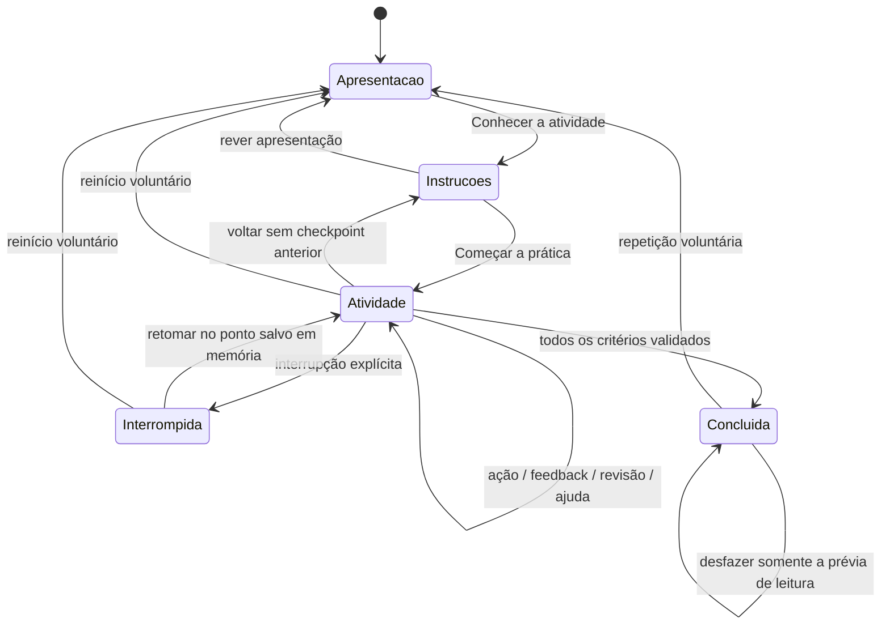

# Motor demonstrativo de micromissões

## U05 — estado vigente

M01–M10 executáveis; M11–M20 informativas. Versão 0.1.0-dev, sem serviços ou persistência. Recortes anteriores abaixo são históricos. [Verificação U05](../AVALIACAO/VERIFICACAO-U05.md).

Criada privacy-decision, com modos account/publication. As modalidades anteriores não representam configuração de acesso e edição de campos com prévia sem alterar seus contratos ou forçar um questionário. Reutilizados MissionRunner, useMissionExecution, redutor, feedback, ajuda, botões, foco, pausas, checkpoints e repetição. PrivacyDefinition/State/Action ampliam uniões discriminadas; privacyMissions.ts guarda dados e regras, privacyDecision.ts é validador puro; PrivacyDecisionActivity e PublicationPreview exibem conta, fluxo e cartão. Sem dependências adicionais.

Etapas prepare → protect → review → done, visual 1/2/3/3. M09: orientação, comparação, estratégia longa/exclusiva com motivos; etapa adicional simulada, distinção do código, uso apenas no acesso iniciado, recusa e explicação. Tentativa de envio é bloqueada e invalida uso até refazê-lo no acesso. M10: finalidade, inspeção de campos, edição reversível com prévia derivada, preservação de título/local/horário, retirada de dados privados; depois público e motivos. Canal público opcional pode permanecer ou ser retirado. Não se valida apenas quantidade de remoções.

Critérios prepared/protected/reviewed são completos só após revisão explícita e confirmação final. edit-privacy preserva decisões e desfaz revisão; revise-preparation preserva edição/estratégia, mas desfaz etapa posterior (uso de código ou público/motivos). Ambos são retorno, sem step_completed indevido. Nenhum estado provoca acesso, SMS ou publicação.

Doze eventos/schemaVersion 2 preservados. action distingue consult-guidance, compare-strategies, choose-strategy, activate-second-factor, choose-code-role, use-code-in-access, attempt-send-code, choose-refusal, inspect/toggle-field, choose-purpose/audience, revisão e confirmação. Payload não inclui código, frase, valor de campo, ID escolhido ou texto livre. Definições U05 em 0.1.0-u05.1. Retorno oficial /#percurso-u05 com foco; aliases de desenvolvimento continuam restritos à U01.


## U04 — estado vigente

M01–M08 executáveis nas rotas oficiais; M09–M20 informativas. Versão 0.1.0-dev. Recortes de autorização e resultados anteriores abaixo são históricos. [Verificação U04](../AVALIACAO/VERIFICACAO-U04.md).

InformationDefinition/State/Action acrescentam kind information-check com mode investigation/sharing. InformationEvidence descreve fonte, autoria, data, contexto e texto integral autoral. informationMissions.ts contém dados e respostas aceitas; informationCheck.ts valida ações sem React/fornecedores; InformationCheckActivity apresenta interação e texto. Não há classificador automático de notícias ou geração dinâmica. Vereditos confirmed/contradicted/unverified são regras editoriais por cenário, testadas também com fixtures de contrato não registradas como missões.

Etapas investigate → decide → review → done (agrupamento visual 1/2/3/3). Consultar todas as pistas e comparar libera decisão, sem concluir. Interpretação deve corresponder às evidências e aos motivos pertinentes, sem justificativas por aparência/repetição/proximidade. M08 acrescenta conduta, resposta respeitosa e próximo passo independente, com alternativas equivalentes. Revisão explícita e ação final completam investigated/justified/decided. Revisar decisões preserva escolhas e invalida confirmação; rever investigação mantém pistas consultadas mas exige nova comparação, descartando critérios posteriores. O redutor trata esses retornos como revisão, sem step_completed indevido.

Reutilizados o ciclo único, ajuda, interrupção/retomada, checkpoints, repetição, feedback polite/atomic e foco. Abrir/reabrir pista foca a região textual; transições focam título; retorno /#percurso-u04 foca unidade. Nada exige leitura visual de montagem: recorte e original têm transcrição textual acessível pelos mesmos controles para todos.

Os doze tipos/schemaVersion 2 permanecem. action identifica open-evidence, compare-evidence, choose-verdict, toggle-reason, choose-conduct/response/next-step, prepare-review, acknowledge-review e finalize-decision. Valores escolhidos, IDs de fontes/pistas, respostas e texto não integram o payload; somente tipos de ação são registrados. Definições U04 versionadas 0.1.0-u04.1. Eventos apenas em memória; não são escores ou dados de pesquisa persistentes. Sem novas dependências, serviços, APIs de compartilhamento ou autenticação.


## Ampliação autorizada — pesquisa U03 (estado vigente)

M01–M06 executáveis; M07–M20 informativas. Mantida versão 0.1.0-dev. As seções U01/U02 abaixo descrevem decisões e evidências históricas, não limites da autorização atual. [Verificação U03](../AVALIACAO/VERIFICACAO-U03.md).

SearchDefinition/State/Action acrescentam kind search ao contrato discriminado. search.ts é validador puro e buscador determinístico; searchMissions.ts contém termos, conjuntos de resultados, fontes/datas fictícias, cartões de lembrete e feedback. SearchActivity é renderer compartilhado, sem condicionais por missionId. Nenhum novo serviço, framework ou dependência.

Etapas query → results → collection → done, visualmente 1/2/3/3. Termos de consulta são cartões predefinidos. Conjunto amplo difere do específico; termo de outro assunto retorna vazio. Consulta pertinente direta é válida: não se obriga um erro inicial. Quando a consulta é insuficiente, precisa ser refinada antes da organização. Resultados específicos ainda contêm distratores antigos/incompletos. Posição não indica pertinência.

M05 exige assunto/contexto, resultado aberto/pertinente, guardar e recuperar. M06 exige adicionalmente três resultados abertos, quadro comparativo, origem e atualidade consultadas para a escolha e cartões corretos de dia/local/fonte. Critérios query/selected/recovered só chegam ao conjunto completo ao recuperar. Editar descarta seleção/lembrete; refinar descarta conferências, coleção e critérios posteriores. Refinar/editar são retornos, sem step_completed. Histórico de checkpoints e eventos continua limitado em memória como antes.

Os doze tipos de evento/schemaVersion 2 permanecem. action diferencia run-search, refine-search, open-result, select-result, inspect-origin/date, compare-results, set-reminder, save/recover-result, sem palavras, valores, IDs selecionados ou texto livre. Ajuda é help_requested, falhas são attempt_incorrect; revisitas não equivalem a aprendizagem. Definições U03 versionadas em 0.1.0-u03.1.

O foco vai aos detalhes abertos (inclusive reabertura da mesma escolha), ao título nas mudanças de etapa e à coleção após guardar. Selects têm rótulo estável e descrição separada com o cartão completo. Feedback reutiliza status polite/atomic. Retorno oficial /#percurso-u03 foca a unidade; aliases /desenvolvimento/u01 continuam restritos à U01.


Apresentação atual: [refinamento UX-01](../AVALIACAO/REFINAMENTO-UX-01.md), preservado na U02. Etapas agrupadas visualmente, detalhes/objetivos e opções sob demanda; interação e feedback prioritários. Verificação atual: 225 testes e check aprovado; [evidências U02](../AVALIACAO/VERIFICACAO-U02.md). Resultados anteriores identificados abaixo preservam o histórico.

10/11/2026 · `0.1.0-dev`. Escopo autorizado: infraestrutura reutilizável e M01–M04 (U01/U02). Sem banco, identidade, persistência, telemetria externa, avaliação com participantes ou publicação. Não há execução de M05–M20.

## Ampliação autorizada — comunicação U02

CommunicationDefinition, CommunicationState e ações discriminadas ampliam o contrato existente com kind communication e mode message/file. Conteúdo em `src/data/communicationMissions.ts`; validador puro em `src/domain/missions/communication.ts`; renderer em CommunicationActivity, com PhraseChoices e AudioAlternative. O ciclo de vida continua exclusivamente no redutor/useMissionExecution, sem motor duplicado.

Etapas: prepare → preview → done. Critérios prepared, reviewed, sent: preparar conjunto pertinente (destino, conteúdo e, em M04, anexo conferido/contexto), abrir prévia, confirmar revisão e simular envio. Nenhuma escolha pode ser alterada durante a prévia; Corrigir escolhas retorna ao preparo e invalida revisão. O redutor trata edit-draft como revisão regressiva, sem step_completed e descartando checkpoints posteriores ao destino. M01/M02 e seus validadores não mudaram.

M03 compõe confirmação por frases equivalentes, saudação/fechamento e Grupo de leitura. Alternativa de áudio é representação com transcrição conferida, sem som ou microfone; alterações invalidam essa conferência. M04 exige programa da oficina, pessoa indicada e contexto; inspeção do anexo é vinculada ao ID atual e troca/remoção a invalida. Documento privado sintético não pode abrir a prévia. Imagens são SVGs locais com alt e conteúdo textual equivalente, sem seletor de arquivos.

Os doze tipos de evento/schemaVersion 2 permanecem; novos tipos de ação entram somente em action, sem valores/IDs selecionados, texto ou arquivo. Definições U02 têm version 0.1.0-u02.1; U01 mantém a anterior. Não é Learning Analytics de pesquisa nem autorização para coleta.

## Acesso e compatibilidade curricular

```sh
npm run dev
```

Abrir diretamente os nós M01–M04 no percurso, sem páginas intermediárias obrigatórias. As quatro rotas de execução são oficiais:

- M01: `/trilhas/primeiros-passos/unidades/operacao-basica-do-celular/missoes/encontrar-os-caminhos-da-tela`.
- M02: `/trilhas/primeiros-passos/unidades/operacao-basica-do-celular/missoes/preparar-a-tela-para-ler-um-convite`.
- M03: `/trilhas/primeiros-passos/unidades/comunicacao-digital/missoes/preparar-uma-mensagem-para-o-grupo`.
- M04: `/trilhas/primeiros-passos/unidades/comunicacao-digital/missoes/compartilhar-o-arquivo-certo-com-a-pessoa-certa`.

O atalho no início também leva à U01 oficial. `/desenvolvimento/u01`, `/desenvolvimento/u01/m01` e `/desenvolvimento/u01/m02` agora apenas redirecionam com replace às rotas oficiais correspondentes; não montam outro player nem criam execução paralela. Os slugs antigos de conteúdo pré-migração continuam com o tratamento explicativo existente. Um endereço desconhecido permanece não encontrado. M02 é acessível independentemente de concluir M01.

Os códigos, títulos, objetivos, cenários e slugs do currículo aprovado permanecem inalterados. Agora M01–M04 executam; M05–M20 continuam com objetivo, cenário e aviso informativo. Os aliases de desenvolvimento permanecem somente na U01. Não há alias semântico entre `conhecendo-o-celular-1` e M01 ou entre `conhecendo-o-celular-2` e M02; as URLs anteriores à migração continuam explicativas, conforme [histórico](../PEDAGOGIA/HISTORICO-MIGRACAO-CURRICULAR.md).

## Separação de responsabilidades

| Camada / arquivo | Responsabilidade |
| --- | --- |
| `src/domain/missions/types.ts` | Contratos, definições discriminadas por modalidade, ações tipadas, estado e eventos. Não importa React, fornecedor ou armazenamento |
| `src/data/demoMissions.ts` | Textos por passo, feedbacks, regras/critério e unidade demonstrativa; título, objetivo e cenário são referenciados da fonte canônica `curriculum.ts` após migração, sem duplicação |
| `src/domain/missions/navigation.ts` | Estado inicial e validação da modalidade de navegação; sem UI ou efeitos |
| `src/domain/missions/reading.ts` | Estado inicial e validação da modalidade de leitura/ajustes; sem controle real do aparelho |
| `src/domain/missions/communication.ts` | Validação compartilhada de preparação, revisão, edição e envio simulado, com regras/configuração M03/M04 |
| `src/data/communicationMissions.ts` | Conteúdo, opções, arquivos sintéticos, regras e definições de M03/M04 |
| `CommunicationActivity.tsx` | Compositor, biblioteca interna, transcrição, prévia e confirmação acessíveis; sem APIs reais |
| `src/domain/missions/execution.ts` | Redutor puro do ciclo de execução, validação de fase/modalidade, conclusão e histórico demonstrativo limitado |
| `src/app/useMissionExecution.ts` | Integra redutor ao useReducer; estado pertence à instância da página |
| `src/components/missions/MissionRunner.tsx` | Composição do fluxo, foco por mudança de fase/tela, progresso, reconhecimento, ajuda e feedback anunciado |
| `MissionPresentation.tsx` | MissionProgress, MissionFeedback e MissionCompletion, compostos dos componentes existentes do sistema de design |
| `NavigationActivity.tsx` | Telas e controles do dispositivo fictício; emite somente ações tipadas |
| `ReadingActivity.tsx` | Controles nativos, prévia isolada, indicação do local e desfazer; ReadingPreview é a apresentação do convite |
| `src/pages/CurriculumPages.tsx` | Resolve slugs e monta o runner para M01–M04; M05–M20 permanecem informativos |
| `src/pages/DemoMissionPages.tsx` | Compatibilidade: redirecionamentos dos três acessos de desenvolvimento, sem player paralelo |

AppLayout, PageHeader, AccessibleButton, BackNavigation, HelpButton, ProgressIndicator, StatusMessage e AchievementBadge foram reutilizados. HelpButton ganhou callback opcional `onOpen` sem alterar o comportamento de usos existentes. ProgressIndicator ganhou rótulo opcional de unidade; seus textos e comportamento padrão permanecem iguais nas trilhas antigas.

## Contrato de definição

`MissionDefinition` é união de `NavigationDefinition`, `ReadingDefinition` e `CommunicationDefinition`; cada uma declara `id` (MissionId), `unitId` (UnitId), `version`, `kind`, `criteria`, `rules` e `content`. routeId é chave interna; o resolver de compatibilidade anterior usa somente m01/m02 da U01, nunca gera rota canônica. Versão U01: 0.1.0-demo.2; versão U02: 0.1.0-u02.1; aplicação: 0.1.0-dev. Título/objetivo/cenário vêm da fonte aprovada. Record por etapa exige título, instrução e ajuda; feedback é código autoral resolvido no conteúdo. Não há campo livre de participante.

Na modalidade navigation, `rules.targetApp` e `rules.detourApp` identificam o alvo e o desvio; os aplicativos fictícios e textos ficam em content.apps. Na reading, `rules.correctLocationId` identifica a informação correspondente ao convite, e `content.locations` contém opções internas. A coerência dessas referências deve ser revista e testada ao adicionar definições.

As regras de transição ficam nos validadores da modalidade; o conteúdo não executa código. A UI não valida acerto por strings de rótulos nem altera critérios diretamente. O redutor só conclui quando todos os IDs de critérios definidos estão presentes no estado validado. Não existe motor genérico de quiz, DSL, eval, carregamento remoto ou modalidades futuras vazias.

## Estados e transições



`ExecutionState.status` distingue not-started, in-progress, completed e interrupted; `phase` controla apresentação, instruções, atividade, conclusão ou pausa. A apresentação pode ser revista depois de iniciar, sem emitir mission_started duplicado. Estado também contém missionId, unitId, definitionVersion, activity, history, resumePhase, feedback, awaitingRetry, events, nextSequence e attempt. `attempt` é ordinal interno de reinício, sem nota, relógio ou comparação. Ações prematuras, de outra modalidade ou definição de versão incompatível são ignoradas. Eventos nunca calculam conclusão.

`previous` volta ao checkpoint anterior da atividade, preservando somente critérios válidos naquele ponto e exigindo refazer os posteriores. Checkpoints são criados em transições validadas, não em cada rádio/clique. Sem checkpoint, retorna às instruções; destas pode retornar à apresentação. O histórico temporário é limitado a vinte checkpoints, suficiente para as etapas suportadas, sem limitar tentativas. Desfazer na M02 elimina os checkpoints posteriores ao destino para não permitir recuperar indevidamente um critério de ajuste.

`interrupt` guarda a fase e conserva atividade/ajustes/critérios na página; ações da simulação ficam suspensas. `resume` restaura o ponto e não conclui nada. A pausa também pode ocorrer nas instruções/apresentação já iniciada; a retomada volta à fase correspondente. `restart` limpa atividade, checkpoints, feedback e critérios, incrementando attempt. `repeat` após conclusão faz o mesmo com motivo distinto. Esses controles não são penalizações. Não se tenta registrar automaticamente fechamento de aba ou inferir abandono.

MissionPage remonta MissionRunner com key do código pedagógico e versão da definição. Sair e voltar, trocar missão/versão ou recarregar cria estado novo. A interrupção só retoma na mesma página montada. Não há retomada persistente, storage, cookie, URL de progresso ou contexto global. Retornar à unidade oficial não conclui a missão.

## M01 — navegação e recuperação

Etapas: encontrar Recados → retornar ao início → visitar Calendário → recuperar Recados passando pelo início → retornar ao início para concluir. A visita orientada ao Calendário faz parte do ensaio, não é registrada como erro.

Critérios:

1. `open-target`: abrir Recados a partir do início.
2. `recover-path`: depois da visita orientada ao Calendário, retornar ao início e abrir Recados novamente.
3. `return-home`: retornar ao início depois da recuperação, não apenas no primeiro retorno.

Abrir Calendário antes do pedido ou Recados no ensaio do desvio mantém a exploração possível e oferece orientação de retorno; não apaga objetivos anteriores. Uma chamada a abrir aplicativo de dentro de outro não satisfaz a regra: é necessário usar o retorno. O botão de retorno e os aplicativos atuam somente no estado da simulação.

## M02 — leitura e ajustes

Etapas: reconhecer dificuldade de texto → experimentar/aplicar ajustes → ler o convite e escolher o local → concluir. O convite e suas opções são fictícios e não usam dados do calendário real.

Critérios:

1. `identify-difficulty`: reconhecer a necessidade descrita de leitura, sem avaliar visão ou audição da pessoa.
2. `apply-adjustment`: aplicar Texto ampliado **ou** Modo de leitura. Não se exige valor numérico único de fonte. Brilho e volume podem ser explorados, mas sozinhos não aumentam o tamanho do texto.
3. `retrieve-information`: identificar “Salão de leitura do Centro Comunitário” a partir do convite após aplicar uma solução pertinente.

Brilho é representação de estado e superfície da prévia, sem filtro que torne instruções ilegíveis; volume é somente estado textual, sem áudio ou API do sistema. As instruções e controles ficam fora da prévia. Desfazer antes da resposta retorna às configurações e exige reaplicar uma solução; depois da conclusão desfaz só a apresentação, mantendo reconhecimento e sem duplicar evento de conclusão. Repetir toda a missão limpa os critérios e valores da prévia.

O pedido desta etapa autoriza controles de brilho e volume simulados; não autoriza novos objetivos de Wi-Fi ou integração nativa. Wi-Fi e prática complementar de brilho/volume permanecem em CP-U01, sem sobrecarregar as duas missões ou substituir tarefas T0/T1/T2.

## Feedback, ajuda e acessibilidade

- Feedback imediato resolve códigos em textos específicos do conteúdo. Erros orientam revisão e não descontam pontos, bloqueiam ajuda ou exigem acertar de primeira.
- Região de status persistente, polite/atomic, apresenta os retornos sem mover foco a cada escolha. O tom visual de dificuldade não cria um alerta assertivo para cada tentativa.
- Mudança de fase, etapa ou tela simulada direciona foco ao h2 do passo. Alterações em grupos de rádio mantêm foco no controle. Voltar entre rotas continua a cargo do AppLayout.
- Ajuda expansível está disponível em apresentação, instruções, prática e conclusão, com orientação do passo. Abrir ajuda emite somente evento local; não muda critérios. Ao mudar de passo, a ajuda fecha e a orientação é atualizada.
- HTML semântico, botões nomeados, fieldsets/legends, radios nativos e estado textual; teclado e toque, sem pinça, arrastar, pressão longa, som obrigatório ou reconhecimento por cor.
- Tamanhos relativos, texto e instruções sem corte, tokens de foco/contraste e movimento reduzido existentes. Os textos da prévia permanecem legíveis; não se reproduz uma barreira sensorial como condição do exercício.
- Progresso representa somente critérios já validados **na página atual**, sem percentual de domínio ou progresso inventado nas trilhas. “Caminho praticado” reconhece a prática efetiva, sem certificado ou nota de pesquisa.

## Modelo preliminar de eventos demonstrativos

Contrato demonstrativo v2, interno e limitado à memória, sem painel, exportação, rede ou armazenamento. As ações vêm de interação local com cenários fictícios; **não são registros de pesquisa com participantes nem resultados científicos**. Metadados são definidos pelo conteúdo e não pela identidade de quem usa a página.

| Tipo | Gatilho |
| --- | --- |
| `mission_started` | Ação explícita de conhecer a atividade; renderizar a página não emite evento |
| `step_started` | Entrada explícita na atividade ou visita a etapa, inclusive retorno e retomada |
| `action_performed` | Ação da modalidade, como abrir app ou aplicar ajustes |
| `help_requested` | Abrir ajuda; fechar não gera nova solicitação |
| `attempt_incorrect` | Validador solicita revisão de ação, sem perda de critérios já válidos |
| `step_completed` | Transição de etapa validada; ajuda, erro, voltar e desfazer não completam etapa |
| `new_attempt` | Próxima ação após uma solicitação de revisão; não significa reinício integral |
| `mission_completed` | Critérios completos pela primeira vez na tentativa corrente |
| `mission_restarted` | Nova tentativa voluntária, com reason repeat ou restart |
| `mission_interrupted` / `mission_resumed` | Interrupção/retomada explícitas na mesma página |
| `previous_step_requested` | Solicitação de rever etapa; não é acerto ou erro |

DemoEvent contém sequence monotônica, source fixo local-demo, missionId e unitId pedagógicos, definitionVersion, schemaVersion 2, attempt, type, step autoral e action opcional (somente tipo da ação). reason é enum repeat/restart quando há reinício. step_completed descreve a etapa de saída; step_started, a etapa de entrada; mission_completed, a etapa final. Etapa concluída não é necessariamente um novo critério: retornar ao início intermediário de M01 é uma etapa necessária, sem aumentar seu contador de três objetivos. Voltar e retomar podem gerar novas visitas à mesma etapa; não contar eventos como nota ou domínio.

Não há data, duração, nome, CPF, telefone, conta, IP, identificador de pessoa, resposta bruta, consulta/URL, preferência real, app real ou captura de tela. Não existe gravação ao fechar aba. Eventos somem ao desmontar a página. A revisão do contrato substituiu activity_started por step_started, incorrect_attempt por attempt_incorrect e voluntary_repetition por mission_restarted com reason repeat. Não houve migração de logs, porque não há persistência.

O histórico mantém no máximo 200 itens em memória; itens antigos saem quando o limite é alcançado. Repetição preserva esse histórico temporário e reinicia critérios, feedback e ajustes. O limite existe para controlar memória, não para limitar tentativas. Não há dependência de eventos antigos para concluir a missão.

Este contrato é diferente dos candidatos E1–E8 de Learning Analytics nos documentos pedagógicos. Não é aprovação de sua instrumentação ou de futura coleta. Integração de backend, vínculo longitudinal, consentimento, retenção e painel precisam de autorização própria e revisão de minimização.

## Como adicionar futuras missões (somente após autorização)

1. Obter autorização de execução e revisar critérios/feedback/alternativas da missão correspondente; títulos/objetivos/cenários da base já estão aprovados. Não implementar M11 ou outra missão por apenas adicionar um item a uma lista.
2. Para modalidade já suportada, definir conteúdo e regras coerentes em dados próprios, com ajuda por etapa e feedback de todas as trajetórias. Não copiar condicionais de UI por missionId.
3. Para nova modalidade autorizada, adicionar estado/ações/definição à união discriminada, validador puro e componente visual; integrar o despacho no redutor e a escolha do renderer, sem antecipar modalidades não solicitadas.
4. Testar estado inicial, ordem de etapas, erro, ajuda, critérios, alternativas equivalentes, repetição, eventos e isolamento de execução. Manter os testes existentes e verificar referências entre regras e conteúdo.
5. Inspecionar acessibilidade da interação e rever documentação. Coleta/persistência jamais é consequência automática de adicionar uma missão.

## Histórico de validação U01 e limites

Verificação atual: `npm run check` aprovado, lint sem avisos, TypeScript sem erros, **174 testes em dez arquivos** e build concluído. Os 153 testes anteriores foram preservados, com expectativas atualizadas somente onde a disponibilidade oficial ou o contrato versionado mudou. Onze testes de domínio e dez testes de integração/ciclo de vida foram acrescentados, incluindo não conclusão por avanço de telas, interrupção/retomada, checkpoints, reinício, eventos e redirecionamentos. M03–M20 e as trinta URLs antigas continuam sob verificação.

Na integração anterior não havia ferramenta de navegador/captura e a verificação era feita em jsdom. A [revisão intermediária da U01](../AVALIACAO/REVISAO-TECNICA-U01.md) encontrou Chrome executável e acrescentou 32 estados examinados em navegador, 13 capturas, medição de alvos/reflow e dois testes, totalizando 176 com check aprovado. O único ajuste de produto foi o mínimo de largura dos links de navegação. Permanecem pendentes zoom real a 200%, fala de leitor de tela, aparelho físico e contraste inconclusivo em cores forçadas; não se afirma conformidade integral WCAG 2.2 ou avaliação com participantes. Os 174 testes e resultados de integração descritos acima são o registro histórico anterior.

Conferência final: servidor local respondeu HTTP 200 em início, U01, M01/M02 oficiais, ficha informativa M03, acesso de desenvolvimento anterior e URL de conteúdo legado. O redirecionamento efetivo de desenvolvimento é cliente-side e foi verificado pelos testes de localização; HTTP 200 de uma SPA não demonstra isso isoladamente. O hash da fonte curricular coincide com o registro da migração, os dois PNGs oficiais estão intactos e 41 links locais de documentação foram verificados. A versão npm permanece 0.1.0-dev.

Arquivos deste recorte: contratos/redutor em `src/domain/missions`, definições e registro em `src/data/demoMissions.ts`, MissionRunner e novo `MissionPresentation.tsx`, integração em `CurriculumPages.tsx` e redirecionamentos em `DemoMissionPages.tsx`. Testes existentes de fluxo/eventos/migração foram adaptados às mudanças autorizadas; novo `src/app/MissionLifecycle.test.tsx` cobre integração e controles. Arquitetura, DSR, roadmap, sistema de design, README, AGENTS e avisos de estágio pedagógicos foram sincronizados. Os validadores centrais de navegação/leitura e os conteúdos curriculares aprovados foram reutilizados sem mudança de objetivo.

Testes do domínio verificam fases, guardas, critérios reais, recuperação, alternativas de leitura, desfazer, repetição e eventos. Testes de interface percorrem as duas missões, teclado, ajuda, retorno, reinício por desmontagem, manutenção das rotas antigas e endereços não implementados. axe-core executa inspeção parcial de fases representativas, com contraste e target-size desativados por não haver renderização em jsdom.

Ainda faltam inspeção real em smartphone/desktop, zoom e reflow, foco não encoberto, leitor de tela, compreensão dos textos e revisão pedagógica. A duração estimada de 5–10 minutos não foi validada. Os instrumentos originais de pesquisa continuam indisponíveis para revisão de não sobreposição dos cenários. Não houve validação completa com WCAG, teste com pessoas idosas ou avaliação de eficácia.
